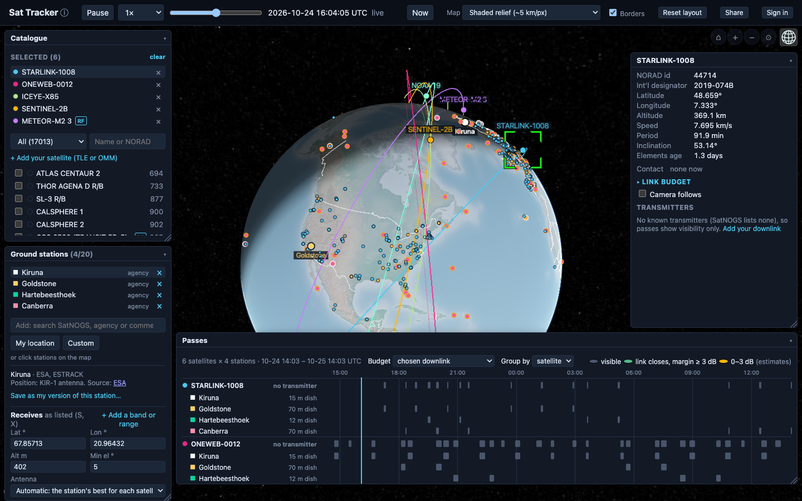
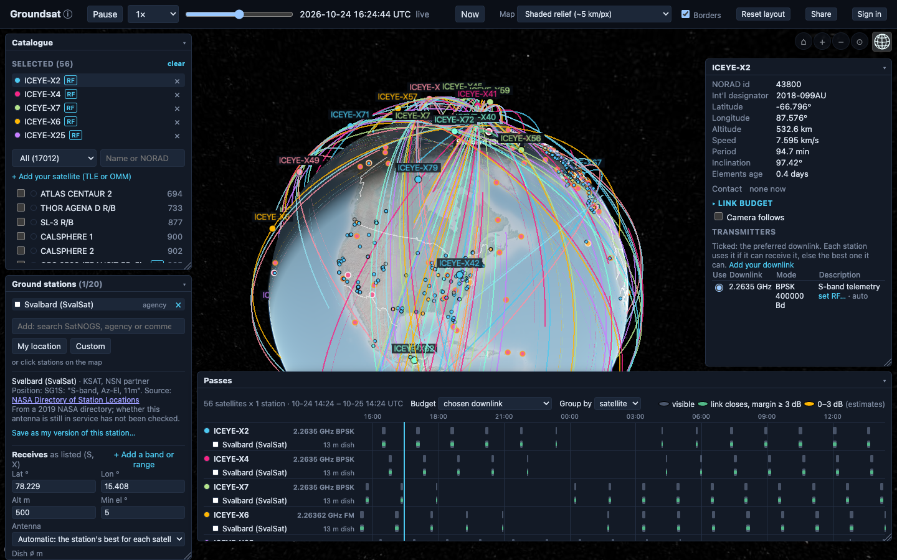
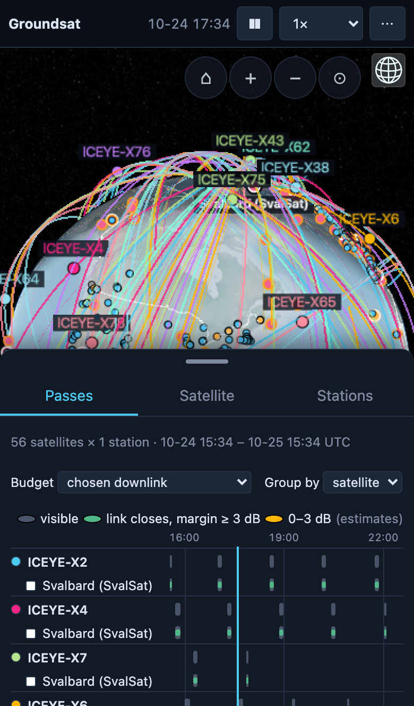
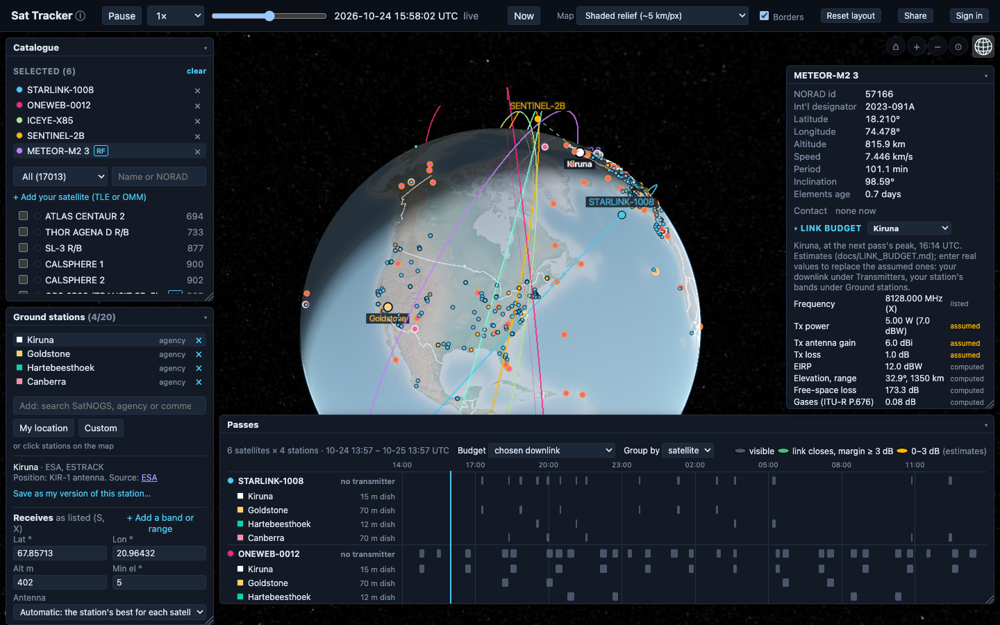
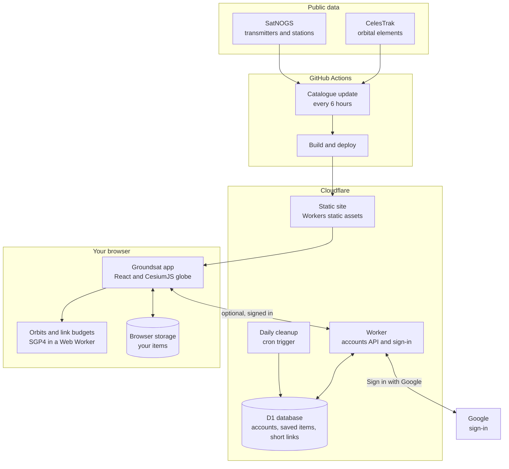

# Groundsat

**See where satellites are, when they pass over a ground station, and whether the radio link would actually close, from the orbit to the margin in dB.**

**[Open groundsat.com →](https://groundsat.com)** Free, no sign-up, works in the browser.

## What you can do

### Track satellites and their passes
Pick from about 17,000 satellites (weather, Earth observation, CubeSats, amateur radio, GNSS…), add ground stations, and see every pass over the next day on a timeline: green where the link closes with margin, amber where it's tight, grey where the satellite is only in view. A whole constellation over one station takes one link:

*Demo: all 56 ICEYE satellites over KSAT's Svalbard station.*

   
  <em>The same view on a phone: the globe full screen, passes in a sheet you drag up. On phones Groundsat is for looking; editing works on a larger screen.</em>

### Use real stations, or describe your own
Over 600 active SatNOGS stations, 25 agency sites (ESA, NASA, JAXA, ISRO…) and about 150 commercial ones (KSAT, SSC, AWS, Leaf Space, ATLAS…), with their dishes and bands. Or save your own station and say exactly what it receives: whole bands or frequency ranges, each with its dish or antenna, LNA noise figure and line loss, or a measured G/T.

### See the whole link budget
Every term for a satellite and a station, now or at the next pass's peak: EIRP, path loss, gases, rain, pointing, G/T, C/N0, Eb/N0, required, margin. Each input is marked as **yours**, **listed** (published data), **assumed** (a typical value for the band) or **computed**, so you can see what's still a guess and replace it with real numbers.

*Demo: six satellites over ESA Kiruna, NASA Goldstone, Hartebeesthoek and Canberra, with METEOR-M2 3's X-band budget (open **Link budget** in the satellite panel).*

### "Can I hear anything from it?"
Satellites often transmit in several bands. Each station budgets the downlink it can actually receive, or, in *any downlink* mode, every downlink it can receive (data, TT&C, beacons), counting the best.

### Share a scenario
One link carries what's on screen (satellites, your stations and their bands, your downlinks, the time and the camera) and each satellite's orbit as it was. The recipient can watch it with today's orbits or **replay it exactly as sent**, and save what they like. Signed in, you get short links too.

## How accurate is it?

- **Orbits:** SGP4/SDP4, the standard model for public orbital elements, via [satellite.js](https://github.com/shashwatak/satellite-js). Checked against Vallado's official SGP4 verification set: 32 test orbits, 666 points, agreement within **0.12 mm**. The verification runs with every build. In practice, accuracy is limited by the public elements themselves: about a kilometre at epoch, growing by a few kilometres a day.
- **Atmosphere:** ITU-R P.676 (gases), P.838 / P.839 / P.618 (rain) and sky noise, from the ITU-Rpy implementation, with reference-value tests.
- **Coding thresholds:** DVB-S2 Es/N0 thresholds and spectral efficiencies checked line by line against ETSI EN 302 307-1, Table 13.
- **What's estimated:** most satellites' transmit power and antenna gain aren't published anywhere, so typical values per band fill in until you enter real ones, always labelled. Not modelled yet: clouds, scintillation, ionospheric effects, Doppler, interference, satellite antenna patterns.

Margins are estimates. Don't use them for operational or safety decisions without independent checks.

## How it's built

- **Your browser does the work.** The app downloads the satellite catalogue once, then computes positions (SGP4), passes and link budgets locally, the heavy part in a background Web Worker, so nothing about what you look at is sent anywhere. What you add is kept in the browser's storage.
- **GitHub Actions keep the data fresh.** Every 6 hours a scheduled job fetches orbital elements from CelesTrak and transmitters and stations from SatNOGS, checks them and packs them into small files; a second job builds the site and deploys it. Your browser never contacts CelesTrak or SatNOGS directly.
- **Cloudflare serves it.** The site is static files on Cloudflare's network (Workers static assets). A small Cloudflare Worker answers only the optional account requests: signing in, saving your items, and short scenario links. It runs only for those, with rate limits.
- **D1 holds accounts.** Cloudflare's SQLite database stores, for signed-in users only, their email address, their saved items and their short links. A daily scheduled task deletes expired sessions and links.
- **Google, only for sign-in.** "Sign in with Google" uses the standard OpenID Connect flow; Groundsat asks Google for your email address and nothing else.
- **Light to load.** A first visit downloads about **3 MB** (compressed): the app and the globe engine (~2.3 MB), the satellite index and stations (~0.3 MB), and only the map tiles in view. Satellite orbits come in 32 small shards, fetched only for the satellites you look at: 56 ICEYE satellites add about 1 MB. Coming back costs only a few tens of KB, because the app code is cached for a year and everything else is just checked for changes; new orbital data arrives when it's refreshed.
- **Made for phones too.** On a phone the layout changes: the globe fills the screen, time and speed sit in a slim bar, and the pass timeline, satellite details and stations live in a sheet you drag up from the bottom. Phones are for looking at shared views and scenarios; adding and editing stay on larger screens.
- **Works without the back end.** Everything except accounts runs from the static files alone, so a copy of the site works on a network with no internet; sign-in simply doesn't appear there.

The diagram is [Mermaid](https://mermaid.js.org) text in this README: edit it like any other text and GitHub redraws it.

## Privacy

No account is needed: what you add is saved in your browser. Signing in (optional, with Google) saves the same things to an account, so they're on every device: we keep your email address and your items, and nothing else. No ads, no analytics, no trackers; the page loads nothing from other sites. Details: [privacy](https://groundsat.com/privacy).

## Data and credits

Orbital elements from [CelesTrak](https://celestrak.org), refreshed every 6 hours. Transmitters and stations from [SatNOGS](https://satnogs.org) (CC BY-SA 4.0). Agency and commercial stations from their operators' published pages, cited per station. Maps: world shaded relief by Tom Patterson ([shadedrelief.com](https://www.shadedrelief.com), public domain), Blue Marble Next Generation imagery courtesy of NASA, and [Natural Earth](https://www.naturalearthdata.com) (public domain). Globe: [CesiumJS](https://cesium.com/platform/cesiumjs/).

The full user guide is the [manual](https://groundsat.com/manual).

## Feedback

Found a bug, a wrong station, or a satellite whose radio details you know? **[Open an issue](../../issues/new)**. Questions and ideas are welcome in **[Discussions](../../discussions)**.

---

This repository holds Groundsat's documentation and issue tracker; the application's source code isn't published. The contents here are licensed under the [MIT License](LICENSE).
